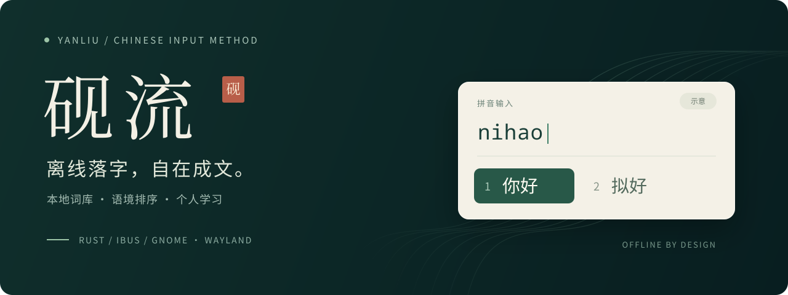
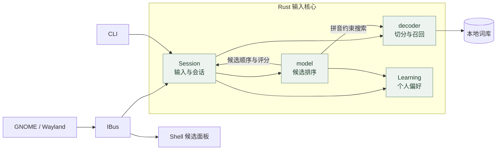
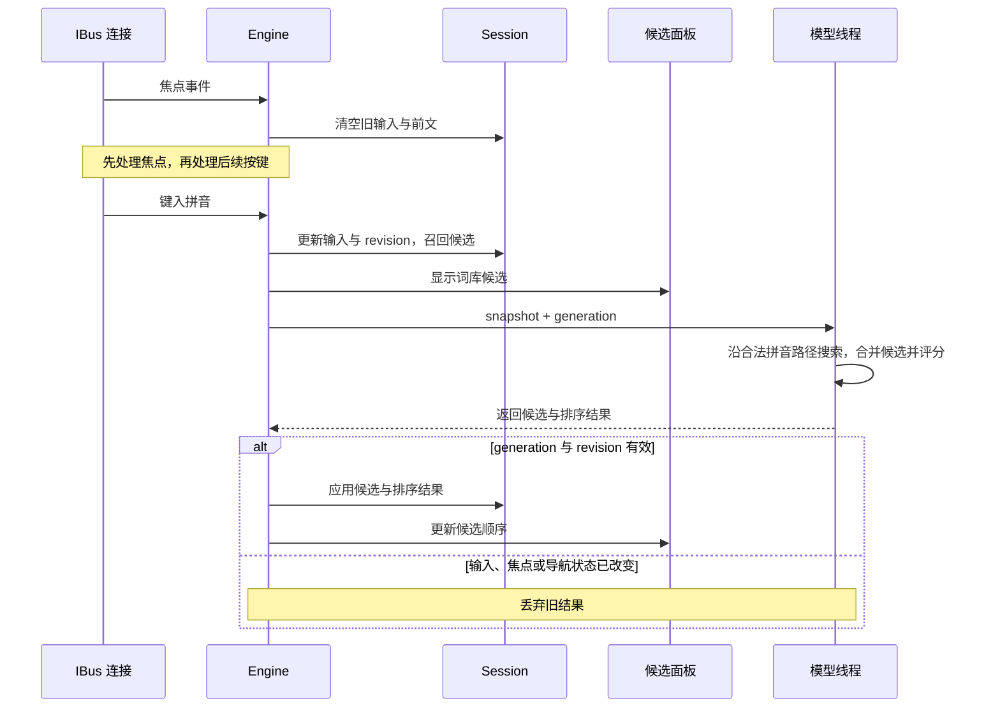
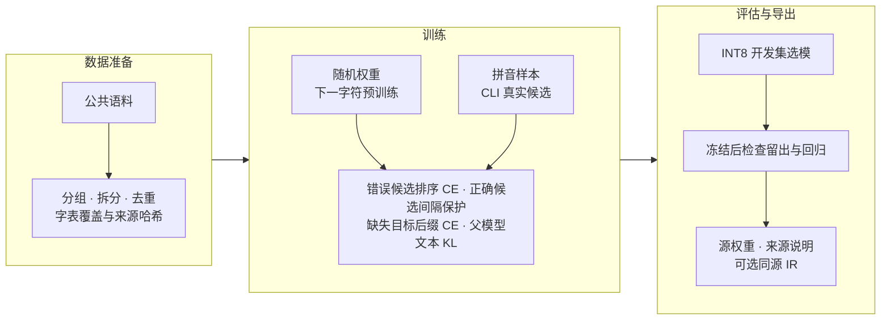

<p align="center">
  
</p>

<p align="center">
  <a href="https://github.com/NEX-S/yanliu/actions/workflows/ci.yml"></a>
  <a href="https://github.com/NEX-S/yanliu/releases/tag/v0.1.0"></a>
  <a href="LICENSE"></a>
</p>

<p align="center">
  <a href="#安装">安装</a> ·
  <a href="#使用">使用</a> ·
  <a href="#模型">模型</a> ·
  <a href="#原理">原理</a> ·
  <a href="docs/DEVELOPMENT.md">开发文档</a>
</p>

砚流是用 Rust 编写的中文拼音输入法，通过 IBus 接入 GNOME / Wayland。词库、模型和选词记录都保存在本机，日常输入不需要联网。

目前是 v0.1.0 预览版，候选排序还在改进。横幅中的面板为输入示意。

## 安装

需要 Rustup、C 链接器、Python 3.11+ 和 IBus。Rust 版本由仓库中的 `rust-toolchain.toml` 指定。

<details>
<summary>系统依赖</summary>

Debian / Ubuntu：

```sh
sudo apt install ibus python3-gi gir1.2-ibus-1.0 python3-venv
```

Fedora：

```sh
sudo dnf install ibus ibus-libs python3-gobject-base
```

Python GI 和 IBus typelib 用于协议测试。本机使用 Fedora 44 / GNOME Wayland，CI 使用 Ubuntu 24.04。

</details>

```sh
git clone https://github.com/NEX-S/yanliu.git
cd yanliu
python3 scripts/fetch_assets.py
./packaging/install-local.sh
```

首次安装会下载词库和模型，并在本机编译 CPU 版本，安装到 `~/.local`。

完成后**注销并重新登录**，在 **GNOME 设置 → 键盘 → 输入源**中添加“砚流”。安装脚本不会切换当前输入源。

已有 CPU 安装可运行 `./packaging/install-local.sh --upgrade`，保留当前模型与上一版资产；显式指定 `YANLIU_MODEL_DIR` 可更换模型。需要回退时运行 `./packaging/install-local.sh --rollback`。操作前正常退出砚流服务，完成后重新加载，配置和选词记录保留。自定义安装位置、GPU/NPU 升级和详细步骤见[安装说明](packaging/README.md)。

## 使用

键入 `nihao`，按空格选择“你好”。支持全拼、简拼、拼音中间编辑、部分选词和常见拼写纠错。

- 空格确认高亮候选，数字 `1–9` 选择当前页候选。
- 上下方向键移动，`PageUp` / `PageDown` 翻页。
- 左右方向键编辑拼音，`Home` / `End` 跳到首尾。
- `Enter` 提交拼音原文，`Esc` 取消，`Ctrl+Space` 切换中英文模式。
- 单引号分隔音节。输入 `ji'cheng` 时，可以先选“吉”，再接着输入 `cheng`。
- 全拼和简拼可以用单引号分开，例如 `xi'anq` 可选择“西安区”，确认后会记住这串输入的选择。
- 单字母可快捷选单字，例如输入 `l` 选择“来”；明确选择后会记住偏好。继续输入到 `lai` 时仍按正常拼音转换。

明确选过的词会记在本机；同一串拼音连续分段选完后，也会记住完整输入和组合文本。即使后来未出现在词库候选中，也可从个人记录中召回。学习记录可以查看、清除或关闭；密码等敏感字段直接透传，不参与学习。完整按键和配置见[使用手册](docs/USER-GUIDE.md)。

开启语境学习后，个人上下文偏好只调整明确选过的原始拼音，同一拼音可以适应不同前文；其他拼音继续使用基础模型。有可靠的模型评分时，学习会根据候选分差控制更新力度，减少一次纠正对其他语境的影响。

<details>
<summary>在终端查看候选</summary>

CLI 与桌面输入共用 Session，可以在安装到桌面前检查候选：

```sh
cargo build --locked --release --bin yanliu
target/release/yanliu decode nihao

# 加载模型，按前文排序
target/release/yanliu --model data/models/sentence-model.safetensors \
  decode xian --context 我去
```

不带 `--model` 时只使用词库。`decode` 和 `evaluate` 不读写桌面选词记录；批量评估方法见[开发文档](docs/DEVELOPMENT.md#cli-评估)。

排查“选过多次却没记住”时，可以用 [`learning replay`](docs/DEVELOPMENT.md#回放个人学习) 在全新目录中回放公开纠正，查看各项评分及保存、重载前后的结果。

</details>

## 模型

默认下载仍是 `models-v2` 的 4M 权重，实际 448 万参数，INT8 文件约 4.73 MB。日常运行只用本机 CPU，不调用远端大模型；已有 CPU 安装升级保留已安装模型。

`models-v4` 提供新一批可选 4M / 7M 权重。两者从各自真实 FP32 父模型继续预训练 1 亿个有效目标；随后三轮排序训练没有提高 INT8 选模指标，均保留排序 epoch 0。后续小模型工作以 4M / 7M 为主，25M 保留为历史版本。

- **7M v4：优先尝试的可选版本。** 实际 719 万参数，INT8 约 7.49 MB。同路径已观测 2,000 条句子首选由历史 7M 的 1,443 升为 1,462，本轮 583 条留出由 434 升为 453；24 条语境首选则由 22 降为 21。详见 [7M v4 模型卡](data/model-cards/yanliu-7m-v4/README.md)。
- **4M v4：较低 CPU 代价的可选版本。** 同路径开发部分首选由历史 4M 的 1,365/1,609 升为 1,405/1,609，本轮留出由 433/583 升为 437/583；已观测句子首选由 1,431/2,000 降为 1,418/2,000。详见 [4M v4 模型卡](data/model-cards/yanliu-4m-v4/README.md)。
- **历史版本。** 默认 [4M v2](data/model-cards/yanliu-4m-v2/README.md)、可选修复版 [4M v3](data/model-cards/yanliu-4m-v3/README.md)及 [25M v2](data/model-cards/yanliu-25m-v2/README.md)保留各自来源与历史结果；[最初的 25M](data/model-cards/yanliu-25m-v1/README.md)也可查阅。

本轮 3,609 条开发数据参与选模，2,000 条句子早已观测并纳入回归保护；583 条只与本轮训练隔离，无法证明未进入历史父模型预训练。所有分母包含未召回目标；自动注音与标签可能有误，这些结果不代表独立泛化或日常输入准确率。

本批 4M / 7M 的三轮串行交错 CPU 回放各含 1,062 帧，进程内 Session 的 action + refine + apply 墙钟 p50 为 **2.523 / 4.147 ms**，p95 为 **17.260 / 26.275 ms**，p99 为 **45.116 / 69.803 ms**；7M 总 CPU 时间为 4M 的 **1.527 倍**。含有界模型召回，不含 IBus、GNOME 绘制或键到屏幕延迟；这组口径不能与旧版历史基准直接比较。

v4 训练正文含获用户明确授权的本地 Claude / Codex / Grok 助手中文。用户授权公开发布选定权重，原始对话与训练正文仍不公开；private-derived 来源分类及权重原始元数据保留，没有匿名化或不会记忆训练内容的保证。混合来源没有统一模型开源许可，NaturalConv、COIG-CQIA、TNEWS 和 Fineweb-Edu 等来源条件见新模型卡的 LICENSE、NOTICE 与 provenance.json。

[models-v4 预发布页](https://github.com/NEX-S/yanliu/releases/tag/models-v4)提供可选 4M / 7M 压缩包和 SHA256SUMS；[v3 发布页](https://github.com/NEX-S/yanliu/releases/tag/models-v3)与[历史 v2 发布页](https://github.com/NEX-S/yanliu/releases/tag/models-v2)保留旧包。解包后显式指定：

```sh
YANLIU_MODEL_DIR=/absolute/path/to/yanliu-7m-v4 \
  ./packaging/install-local.sh
```

默认资产仍由 `fetch_assets.py` 下载并校验 SHA-256；`python3 scripts/fetch_assets.py --verify-only` 检查的是默认清单资产。历史公开语料训练与复现范围见[训练记录](data/training/retrain-v2/README.md)，旧版来源复核见[模型来源复核](data/model-cards/SOURCE-REVIEW.md)。

## 原理

词库先给出候选，本地字符模型根据前文补充拼音组合、调整候选顺序。IBus 和 CLI 使用同一套输入、编辑和选词代码。



词库在启动时加载。逐键处理先显示词库结果，再把候选快照交给模型线程。CPU 模型沿着词库提供的单字读音搜索，补充至多十二个完整拼音组合，让部分低频字有机会在静态剪枝前参与比较。合并候选后，按提升门槛确定首选，再用已有分数排列其余已评分候选，减少翻页。每个新增转换都必须对应实际输入，原有普通转换的身份和静态分数保持不变。

选中部分候选后，Session 保留剩余拼音。默认学习保存所选拼音、文本和次数；开启 `contextual_learning` 后，还可以按前文学习个人偏好。配置和数据管理见[本地学习](docs/USER-GUIDE.md#学习)。

<details>
<summary>按键与异步排序</summary>



每次修改输入都会更新 revision，IBus 另用 generation 标记排序任务。焦点切换、导航、重置和敏感模式会使旧任务失效。队列和学习持久化的实现见[开发文档](docs/DEVELOPMENT.md#输入与异步排序)。

</details>

<details>
<summary>数据与训练</summary>

公共语料来自固定版本的 NaturalConv、CPED、LCCC、中文 Wikipedia、COIG-CQIA 人类回答和 TNEWS。先按会话、页面或问题划分数据，再做清洗和去重。各来源的使用条件分别保留；公开可下载不代表具有统一的开放许可。



训练支持 CPU / FP32 和 Intel GPU / BF16。开发集用于选模，留出集在权重与策略确定后评估；未召回的目标也计入分母。环境准备、脚本用法和实验配置见[训练说明](docs/DEVELOPMENT.md#训练排序模型)。

</details>

## 开发

构建、测试、候选评估和训练命令见[开发文档](docs/DEVELOPMENT.md)。也可以通过 llmux 调用 deepseek-flash 生成公开合成案例，输入法本身不调用远端模型。

候选问题请在 [Issues](https://github.com/NEX-S/yanliu/issues) 中附上可公开的拼音、前文、期望结果和实际排名，或提交一条 `evaluate` 能读取的 JSONL。请勿附带私人文本、选词记录或密钥。代码约定见 [AGENTS.md](AGENTS.md)。

## 许可

代码采用 [GPL-3.0-or-later](LICENSE)。词库、模型和 vendor 保留各自许可与署名，见[第三方说明](data/THIRD_PARTY.md)；固定来源与 SHA-256 见[资产清单](data/manifest.json)。

混合语料训练的模型没有统一开源许可。NaturalConv 官方条款限制为个人、非商业科研等指定用途，COIG-CQIA 与 TNEWS 的部分授权条件仍待核实；详见[来源复核](data/model-cards/SOURCE-REVIEW.md)。代码许可不替模型的数据来源补充授权。
