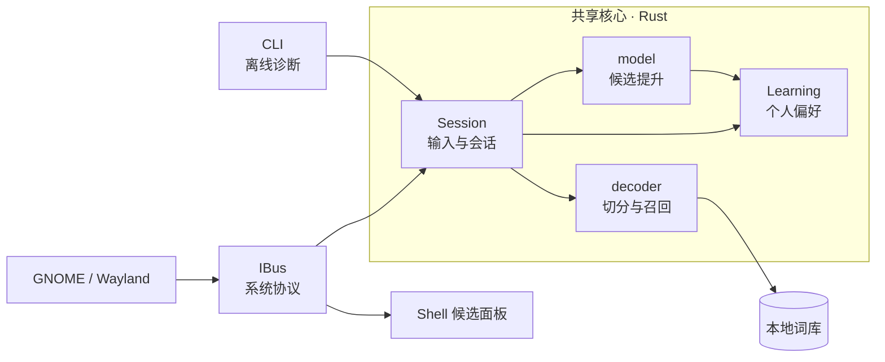
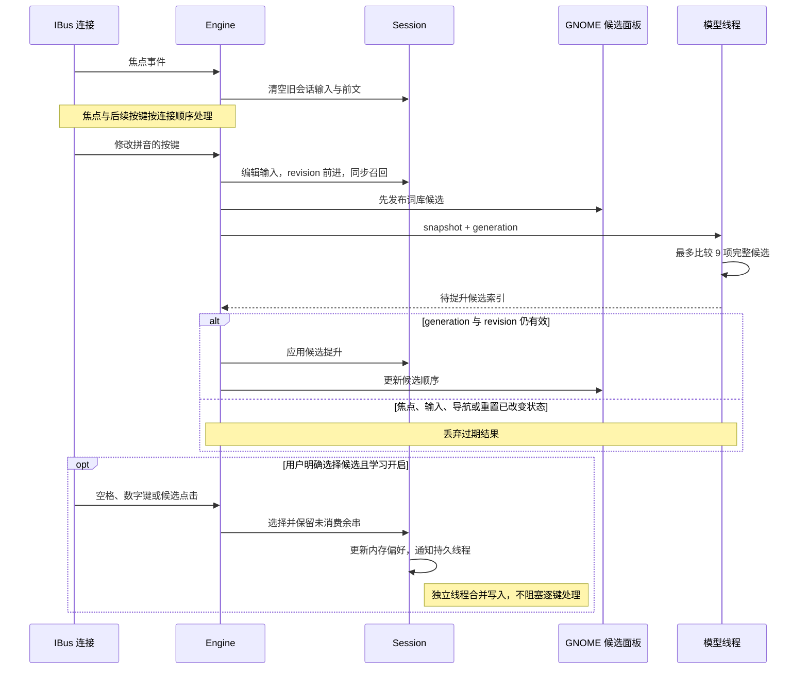
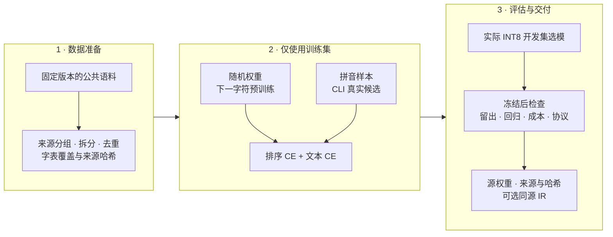

<p align="center">
  
</p>

<h1 align="center">砚流 · Yanliu</h1>

<p align="center">
  用 Rust 写的离线中文拼音输入法<br>
  本地词库召回 · 语境候选排序 · 个人选词学习
</p>

<p align="center">
  <a href="https://github.com/NEX-S/yanliu/actions/workflows/ci.yml"></a>
  <a href="https://github.com/NEX-S/yanliu/releases/tag/v0.1.0"></a>
  <a href="LICENSE"></a>
  
</p>

<p align="center">
  <a href="#快速开始">快速开始</a> ·
  <a href="#架构一套核心两个入口">架构图解</a> ·
  <a href="docs/USER-GUIDE.md">使用手册</a> ·
  <a href="packaging/README.md">安装与卸载</a> ·
  <a href="docs/DEVELOPMENT.md">开发指南</a> ·
  <a href="https://github.com/NEX-S/yanliu/releases/tag/v0.1.0">下载模型</a>
</p>

---

砚流通过 **IBus** 接入桌面，由 **GNOME Shell** 显示候选面板。词库负责切分与组合，本地字符语言模型结合应用提供的前文，从真实召回结果中提升候选；明确的选词会积累为本地偏好。

首次获取依赖与资产需要网络，**日常输入完全离线**。默认走轻量 CPU 路径；需要时可显式启用 OpenVINO，在 GPU / NPU 上运行同源模型。

> [!IMPORTANT]
> 当前为 **v0.1.0 技术预览**，候选仍可能误排。随附合成数据用于开发与回归，不代表自然用户准确率。横幅中的候选面板为输入示意。

## 为中文输入而做

- **先看到候选，再结合前文排序。** 逐键发布词库候选，本地模型随后更新；排序只提升真实候选，保留其原始身份与消费范围。
- **把输入留在自己的设备上。** 密码与敏感字段直接透传，不采集上下文或学习；默认偏好只保存明确选中的拼音、文本与次数。
- **输入可以接着改。** 支持拼音光标编辑、部分选词、音节分隔，以及相邻换位、邻键替换和漏键恢复。
- **词表与学习由你掌握。** 可加载自备 Rime 子集词表；学习可关闭、查看、清除，语境学习需显式开启。
- **桌面使用，终端也能验证。** CLI 与 IBus 共用 Session 输入处理路径，可直接检查候选和回放公开案例。

## 架构：一套核心，两个入口

项目保持**单个 Rust 包**。IBus 负责系统协议，CLI 负责离线诊断；拼音编辑、词库召回、候选提升和明确选词学习复用同一套核心。模块调用关系如下：



- **Dictionary / decoder** 在本地索引中召回词条，进行音节切分、组合和有界纠错；词库在启动时加载，逐键路径不读磁盘。
- **Session** 保存原始拼音、光标和候选。选择部分候选后，按实际消费的输入字节删除前缀，留下余串继续输入。
- **model** 只返回一个真实候选的提升索引。候选文本、来源、静态分数和消费范围都由召回路径决定。
- **IBus / CLI** 共用上述行为；候选面板由 GNOME Shell 绘制，CLI 的 `decode` / `evaluate` 与桌面个人学习隔离。

## 快速开始

需要 **Rustup、系统 C 链接器、Python 3.11+ 和 IBus**。仓库固定 Rust 1.98.0；构建应在实际使用的机器上进行。

<details>
<summary>安装 IBus 与协议测试依赖</summary>

Debian / Ubuntu：

```sh
sudo apt install ibus python3-gi gir1.2-ibus-1.0
```

Fedora：

```sh
sudo dnf install ibus ibus-libs python3-gobject-base
```

Python GI 与 IBus typelib 用于协议测试；开发脚本使用虚拟环境时，Debian / Ubuntu 另需 `python3-venv`。本机验证环境为 Fedora 44 / GNOME Wayland，CI 使用 Ubuntu 24.04。

</details>

**1. 获取源码与固定资产**

```sh
git clone https://github.com/NEX-S/yanliu.git
cd yanliu
python3 scripts/fetch_assets.py
```

下载时校验 SHA-256；已有资产可用 `python3 scripts/fetch_assets.py --verify-only` 验证。

**2. 安装到当前用户**

```sh
./packaging/install-local.sh
```

脚本会构建 CPU release 服务，并安装到 `~/.local`。完成后**注销并重新登录**，在 **GNOME 设置 → 键盘 → 输入源**中添加“砚流”。安装不会自动切换输入源。

**3. 开始输入**

键入 `nihao`，按空格选择“你好”。`Enter` 提交拼音原文，`Esc` 取消，`Ctrl+Space` 切换中英文模式。

升级或重装前先运行 `./packaging/uninstall-local.sh`；卸载保留配置和个人学习。自定义前缀、GPU / NPU 与完整安装过程见[安装说明](packaging/README.md)。

### 先在终端试一试

无需安装到桌面即可检查候选：

```sh
cargo build --locked --release --bin yanliu
target/release/yanliu decode nihao

# 加载本地模型，结合前文排序
target/release/yanliu --model data/models/sentence-model.safetensors \
  decode xian --context 我去
```

CLI 不带 `--model` 时只使用词库。`decode` 与 `evaluate` 不读写系统学习状态；批量案例与训练工具见[开发指南](docs/DEVELOPMENT.md)。

## 日常操作

- **选词：** 空格确认高亮候选，数字 `1–9` 选择当前页候选；部分选择保留剩余拼音。
- **候选导航：** 上下方向键或 `Ctrl+H/L` 移动，`PageUp/PageDown` 或 `Ctrl+K/J` 翻页。
- **编辑拼音：** 左右方向键移动光标，`Home/End` 跳到首尾；`Enter` 提交原文，`Esc` 取消。
- **英文与标点：** `Ctrl+Space` 切换英文透传；中文模式转换常用中文标点，单引号用于分隔音节。

拼音显示在候选面板中，`▏` 标出编辑位置，确认前不改应用正文。完整按键行为、标点规则与敏感字段处理见[输入操作](docs/USER-GUIDE.md#输入操作)。

## 一次按键，如何变成候选

**先发布词库结果，再异步尝试提升。** 输入路径不等待字符模型；单独的模型线程处理有界任务队列，每个引擎只保留最新待处理任务，总待处理量上限为 32。



Session 的 **revision** 与 IBus 引擎的 **generation** 共同限制异步结果的有效期。焦点切换、重置、敏感模式、销毁和用户导航都会使旧任务失效，避免候选在翻页或切换应用后突然被旧结果改写。

### 词频、上下文与生僻字

排序从完整消费当前输入、且非 Completion 的候选中选取**至多 9 项**，预留不同字长的比较机会。模型结合前文给出语言分；精确词条的静态词频差提供先验，候选须超过首选的提升门槛才会被移到前面，其余候选保持相对顺序。普通完整转换仍优先于纠错。

无前文的词库精确首选、已学习的首选有相应保护。词表外候选不因共享 `<unk>` 概率获得语言优势：它的语言分与首选持平，继续由静态词频和明确选择区分。首选本身无法完整表示时，整组语言先验保持中性。

**模型工作量有界，单字仍可翻页查找。** 普通组合搜索使用有限 beam 和候选预算；完整单音节，以及用单引号明确分隔的首音节，会另保留词典中的全部同音单字。例如 `ji'cheng` 可以翻页选择“吉”，随后继续输入 `cheng`。

### 个人学习如何生效

默认学习保存**实际消费的拼音、所选文本和次数**，最多保留 4,096 对偏好。明确选择会更新内存中的偏好，独立线程约每 250 ms 合并突发更新，以原子替换保存快照；正常退出会完成最后一次写入。

显式开启 `contextual_learning` 后，还会用有限前文和真实候选的纠正更新 **4,096 维本地条件参数**，与次数偏好保存在同一快照中。它不记录明文前文或候选日志，但参数本身仍应作为私人数据管理。`Enter` 提交的原文、Completion 未输入的部分以及敏感字段不参与学习。

核心实现可从 [Session](src/session.rs)、[候选提升](src/model.rs)、[本地学习](src/learning.rs)和 [IBus 适配](src/ibus.rs)开始阅读；搜索预算与评分规则见[开发指南](docs/DEVELOPMENT.md#候选与排序)。

## 选择模型

**默认 4M · 开箱路径**

`fetch_assets.py` 获取固定的公共原版 4M 字符模型，默认 CPU 安装直接使用它。

**可选 25M · 公开训练版**

[v0.1.0 发布附件](https://github.com/NEX-S/yanliu/releases/tag/v0.1.0) 提供 `yanliu-25m-v1.tar.gz` 与 `SHA256SUMS`，包含源权重和同源 OpenVINO IR。[模型卡](data/model-cards/yanliu-25m-v1/README.md)记录来源、哈希和评测限制，[训练配方](data/training/yanliu-25m-v1/README.md)可供复现。

解包后，可在首次 CPU 安装时指定：

```sh
YANLIU_MODEL_DIR=/absolute/path/to/yanliu-25m-v1 \
  ./packaging/install-local.sh
```

**从零训练 · 自己控制词表与语料**

仓库提供公共中文语料准备、拼音排序样本构建、随机权重预训练和真实候选微调工具，支持 CPU / FP32 与显式 Intel GPU / BF16 训练。字符表可以在训练前覆盖全部 8,105 个规范汉字，并分别核对 3,500 个一级常用字的词表覆盖、正文出现次数和未知字比例。

本机的新一轮实验采用 **6 层、4 个注意力头、隐藏维度 256、9,506 项词表、64 字符窗口**，约 719 万参数，INT8 源权重约 7.14 MiB。**这组新权重尚未作为 GitHub Release 附件发布**；上面的默认 4M 和已发布 25M 仍是公开下载入口，不能把本机实验结果当作默认安装的成绩。

**可选 GPU / NPU · 显式启用**

需要 `accelerator` 构建、同源 IR、单独的 OpenVINO 原生运行库及可用硬件与驱动。运行库与驱动不包含在模型包中；设备失败会报出原因，不自动换回 CPU。GPU 使用 FP32，NPU 在近似并列时可能与 CPU 排序不同。准备与安装步骤见[设备配置](packaging/README.md)。

## 从语料到模型

运行时使用本地模型；数据准备、训练和候选评估在开发阶段完成。公共语料流程使用固定版本的 LCCC 对话、中文 Wikipedia、COIG-CQIA 人类回答和 TNEWS 标题，先按会话、页面或问题分组拆分，再清洗与去重。



- **预训练**按段落学习下一字符，不跨段拼接；未知字符保留在输入上下文中，PAD / UNK 目标不计损失。
- **排序微调**使用真实 CLI 召回与运行时相同的词频先验、提升门槛和未知字策略，训练不会向候选池注入目标。可同时加入普通文本交叉熵（CE），帮助保留语言能力。
- **选模与留出分开**：开发集用于选择实际 INT8 checkpoint；最终留出在权重与策略冻结后评估。报告保留完整分母、未召回案例，以及逐例救回和退化。
- **性能按设备实测**：默认 CPU 直接使用 Rust 推理与前缀缓存；显式 GPU / NPU 使用固定形状 IR。Session 回放能检查处理成本，不能替代 GNOME 绘制与真实键到屏幕延迟。

训练命令、依赖环境、数据格式与复现边界见[开发指南](docs/DEVELOPMENT.md#从随机权重训练)。各资产保留实际来源与许可声明，训练产物不会自动安装或发布。

## 让它适合你的输入

安装后的配置位于 `~/.config/yanliu/config.json`，修改后需重启服务或重新登录。

- [配置参考](docs/USER-GUIDE.md#配置)：模型路径、设备、用户词表与学习开关。
- [本地学习](docs/USER-GUIDE.md#学习)：偏好保存、可选语境学习与数据清除。语境参数也可能记住私人信息，请按私人数据管理。
- [用户词表](docs/USER-GUIDE.md#用户词表)：使用你维护的 UTF-8 Rime 子集文件。

## 开发与贡献

从[开发指南](docs/DEVELOPMENT.md)开始，那里包含候选机制、CLI 评估、公开合成数据生成、训练与验证命令。开发侧可通过 llmux 调用 deepseek-flash 生成公开合成案例，再用固定拼音库注音；输入法运行时不接入远端模型。

欢迎在 [Issues](https://github.com/NEX-S/yanliu/issues) 提交可复现的问题。候选问题请附**最小公开输入、前文、期望候选与实际排名**，也可提供 `evaluate` 可读取的 JSONL。请勿提交私人应用上下文、词表、学习快照、密钥或本地对话记录。Agent 开发约束见 [AGENTS.md](AGENTS.md)。

## 许可与致谢

主项目采用 [GPL-3.0-or-later](LICENSE)。砚流使用的词库、模型和 vendor 保留各自许可与署名；固定来源和 SHA-256 见[资产清单](data/manifest.json)，完整说明见[第三方来源与许可](data/THIRD_PARTY.md)。

感谢开放词库、语言模型和输入法基础设施的维护者，让中文输入可以在本地继续生长。
