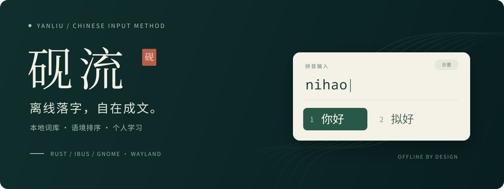
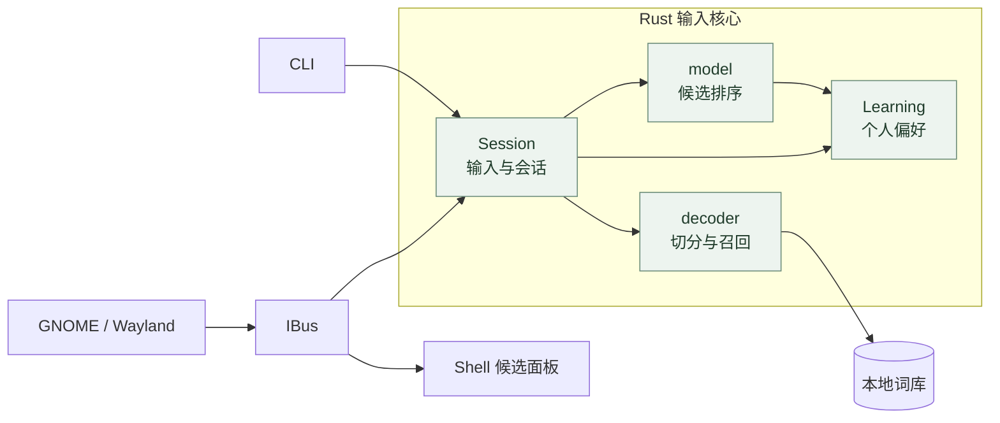
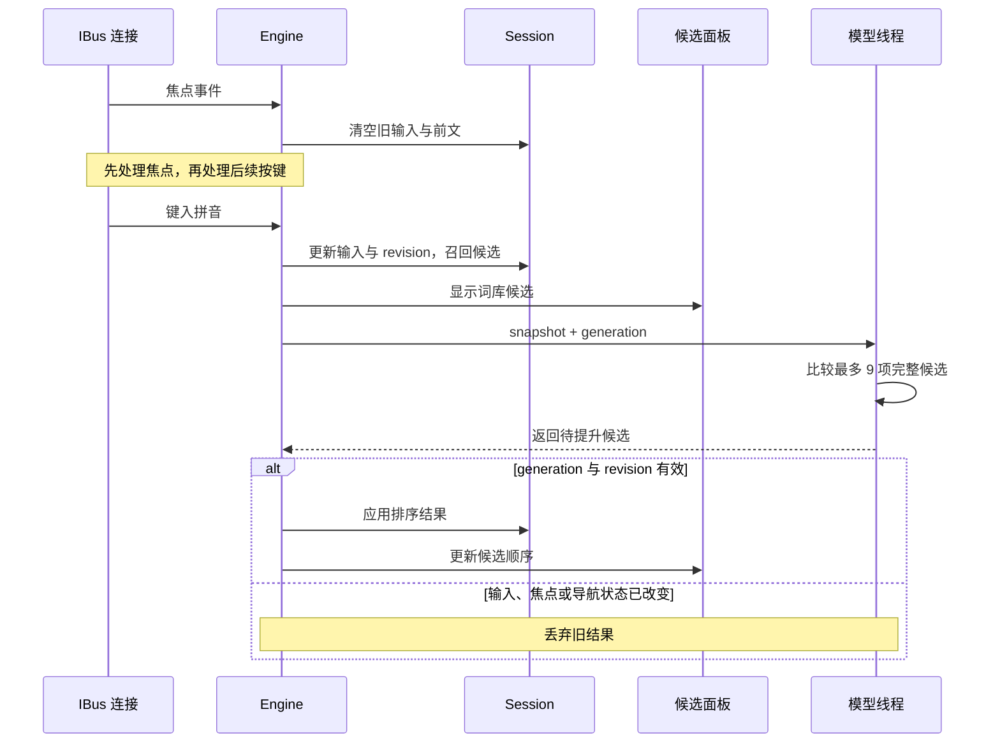
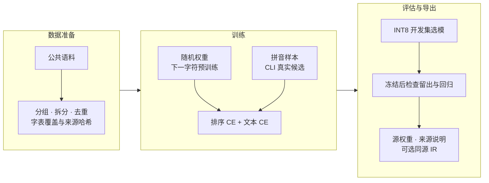

<p align="center">
  
</p>

<p align="center">
  <a href="https://github.com/NEX-S/yanliu/actions/workflows/ci.yml"></a>
  <a href="https://github.com/NEX-S/yanliu/releases/tag/v0.1.0"></a>
  <a href="LICENSE"></a>
</p>

<p align="center">
  <a href="#安装">安装</a> ·
  <a href="#使用">使用</a> ·
  <a href="#模型">模型</a> ·
  <a href="#原理">原理</a> ·
  <a href="docs/DEVELOPMENT.md">开发文档</a>
</p>

砚流是用 Rust 编写的中文拼音输入法，通过 IBus 接入 GNOME / Wayland。词库、模型和选词记录都保存在本机，日常输入不需要联网。

目前是 v0.1.0 预览版，候选排序还在改进。横幅中的面板为输入示意。

## 安装

需要 Rustup、C 链接器、Python 3.11+ 和 IBus。Rust 版本由仓库中的 `rust-toolchain.toml` 指定。

<details>
<summary>系统依赖</summary>

Debian / Ubuntu：

```sh
sudo apt install ibus python3-gi gir1.2-ibus-1.0 python3-venv
```

Fedora：

```sh
sudo dnf install ibus ibus-libs python3-gobject-base
```

Python GI 和 IBus typelib 用于协议测试。本机使用 Fedora 44 / GNOME Wayland，CI 使用 Ubuntu 24.04。

</details>

```sh
git clone https://github.com/NEX-S/yanliu.git
cd yanliu
python3 scripts/fetch_assets.py
./packaging/install-local.sh
```

首次安装会下载词库和模型，并在本机编译 CPU 版本，安装到 `~/.local`。

完成后**注销并重新登录**，在 **GNOME 设置 → 键盘 → 输入源**中添加“砚流”。安装脚本不会切换当前输入源。

升级或重装前先运行 `./packaging/uninstall-local.sh`，配置和选词记录会保留。自定义安装位置、GPU / NPU 配置见[安装说明](packaging/README.md)。

## 使用

键入 `nihao`，按空格选择“你好”。支持全拼、简拼、拼音中间编辑、部分选词和常见拼写纠错。

- 空格确认高亮候选，数字 `1–9` 选择当前页候选。
- 上下方向键移动，`PageUp` / `PageDown` 翻页。
- 左右方向键编辑拼音，`Home` / `End` 跳到首尾。
- `Enter` 提交拼音原文，`Esc` 取消，`Ctrl+Space` 切换中英文模式。
- 单引号分隔音节。输入 `ji'cheng` 时，可以先选“吉”，再接着输入 `cheng`。

明确选过的词会记在本机。学习记录可以查看、清除或关闭；密码等敏感字段直接透传，不参与学习。完整按键和配置见[使用手册](docs/USER-GUIDE.md)。

<details>
<summary>在终端查看候选</summary>

CLI 与桌面输入共用 Session，可以在安装到桌面前检查候选：

```sh
cargo build --locked --release --bin yanliu
target/release/yanliu decode nihao

# 加载模型，按前文排序
target/release/yanliu --model data/models/sentence-model.safetensors \
  decode xian --context 我去
```

不带 `--model` 时只使用词库。`decode` 和 `evaluate` 不读写桌面选词记录；批量评估方法见[开发文档](docs/DEVELOPMENT.md#cli-评估)。

</details>

## 模型

默认使用公共的 4M 字符模型，由 `fetch_assets.py` 下载并校验 SHA-256。已下载的资产可用 `python3 scripts/fetch_assets.py --verify-only` 检查。

[v0.1.0 发布页](https://github.com/NEX-S/yanliu/releases/tag/v0.1.0)另提供 25M 模型，压缩包包含源权重、同源 OpenVINO IR 和来源说明。解包后可在首次安装时指定：

```sh
YANLIU_MODEL_DIR=/absolute/path/to/yanliu-25m-v1 \
  ./packaging/install-local.sh
```

来源和评测限制见 [25M 模型卡](data/model-cards/yanliu-25m-v1/README.md)，复现方法见[训练配方](data/training/yanliu-25m-v1/README.md)。合成案例的命中率不代表日常输入准确率。

## 原理

词库先给出候选，本地字符模型再根据前文调整首选。IBus 和 CLI 使用同一套输入、编辑和选词代码。



词库在启动时加载。逐键处理先显示词库结果，再把候选快照交给模型线程。模型只比较真实候选，最多提升其中一项；候选文本和消费的拼音范围保持不变。

选中部分候选后，Session 保留剩余拼音。默认学习保存所选拼音、文本和次数；开启 `contextual_learning` 后，还可以按前文学习个人偏好。配置和数据管理见[本地学习](docs/USER-GUIDE.md#学习)。

<details>
<summary>按键与异步排序</summary>



每次修改输入都会更新 revision，IBus 另用 generation 标记排序任务。焦点切换、导航、重置和敏感模式会使旧任务失效。队列和学习持久化的实现见[开发文档](docs/DEVELOPMENT.md#输入与异步排序)。

</details>

<details>
<summary>数据与训练</summary>

公共语料来自固定版本的 LCCC、中文 Wikipedia、COIG-CQIA 人类回答和 TNEWS。先按会话、页面或问题划分数据，再做清洗和去重。



训练支持 CPU / FP32 和 Intel GPU / BF16。开发集用于选模，留出集在权重与策略确定后评估；未召回的目标也计入分母。环境准备、脚本用法和实验配置见[训练说明](docs/DEVELOPMENT.md#训练排序模型)。

</details>

## 开发

构建、测试、候选评估和训练命令见[开发文档](docs/DEVELOPMENT.md)。也可以通过 llmux 调用 deepseek-flash 生成公开合成案例，输入法本身不调用远端模型。

候选问题请在 [Issues](https://github.com/NEX-S/yanliu/issues) 中附上可公开的拼音、前文、期望结果和实际排名，或提交一条 `evaluate` 能读取的 JSONL。请勿附带私人文本、选词记录或密钥。代码约定见 [AGENTS.md](AGENTS.md)。

## 许可

代码采用 [GPL-3.0-or-later](LICENSE)。词库、模型和 vendor 保留各自许可与署名，见[第三方说明](data/THIRD_PARTY.md)；固定来源与 SHA-256 见[资产清单](data/manifest.json)。
