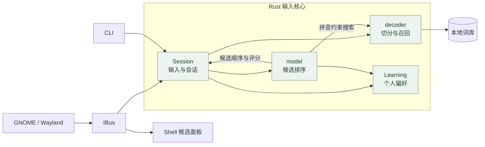
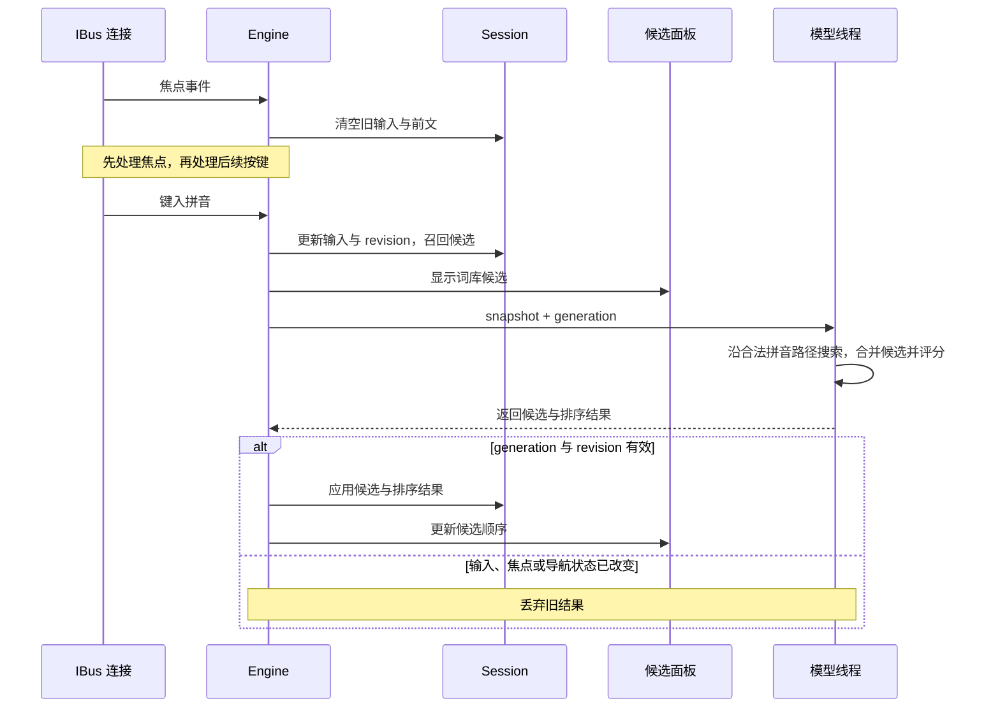
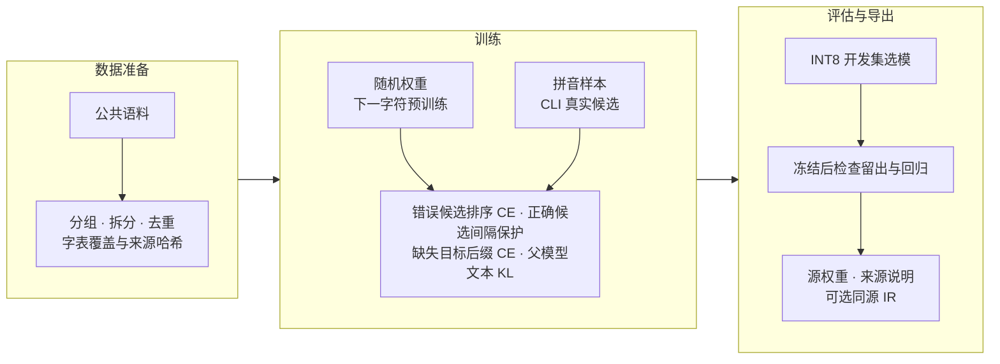

<p align="center">
  
</p>

<p align="center">
  <a href="https://github.com/NEX-S/yanliu/actions/workflows/ci.yml"></a>
  <a href="https://github.com/NEX-S/yanliu/releases/tag/v0.1.0"></a>
  <a href="LICENSE"></a>
</p>

<p align="center">
  <a href="#安装">安装</a> ·
  <a href="#使用">使用</a> ·
  <a href="#模型">模型</a> ·
  <a href="#原理">原理</a> ·
  <a href="docs/DEVELOPMENT.md">开发文档</a>
</p>

砚流是用 Rust 编写的中文拼音输入法，通过 IBus 接入 GNOME / Wayland。词库、模型和选词记录都保存在本机，日常输入不需要联网。

目前是 v0.1.0 预览版，候选排序还在改进。横幅中的面板为输入示意。

## 安装

需要 Rustup、C 链接器、Python 3.11+ 和 IBus。Rust 版本由仓库中的 `rust-toolchain.toml` 指定。

<details>
<summary>系统依赖</summary>

Debian / Ubuntu：

```sh
sudo apt install ibus python3-gi gir1.2-ibus-1.0 python3-venv
```

Fedora：

```sh
sudo dnf install ibus ibus-libs python3-gobject-base
```

Python GI 和 IBus typelib 用于协议测试。本机使用 Fedora 44 / GNOME Wayland，CI 使用 Ubuntu 24.04。

</details>

```sh
git clone https://github.com/NEX-S/yanliu.git
cd yanliu
python3 scripts/fetch_assets.py
./packaging/install-local.sh
```

首次安装会下载词库和模型，并在本机编译 CPU 版本，安装到 `~/.local`。

完成后**注销并重新登录**，在 **GNOME 设置 → 键盘 → 输入源**中添加“砚流”。安装脚本不会切换当前输入源。

已有 CPU 安装可运行 `./packaging/install-local.sh --upgrade`，保留当前模型与上一版资产；显式指定 `YANLIU_MODEL_DIR` 可更换模型。需要回退时运行 `./packaging/install-local.sh --rollback`。操作前正常退出砚流服务，完成后重新加载，配置和选词记录保留。自定义安装位置、GPU/NPU 升级和详细步骤见[安装说明](packaging/README.md)。

## 使用

键入 `nihao`，按空格选择“你好”。支持全拼、简拼、拼音中间编辑、部分选词和常见拼写纠错。

- 空格确认高亮候选，数字 `1–9` 选择当前页候选。
- 上下方向键移动，`PageUp` / `PageDown` 翻页。
- 左右方向键编辑拼音，`Home` / `End` 跳到首尾。
- `Enter` 提交拼音原文，`Esc` 取消，`Ctrl+Space` 切换中英文模式。
- 单引号分隔音节。输入 `ji'cheng` 时，可以先选“吉”，再接着输入 `cheng`。
- 全拼和简拼可以用单引号分开，例如 `xi'anq` 可选择“西安区”，确认后会记住这串输入的选择。
- 单字母可快捷选单字，例如输入 `l` 选择“来”；明确选择后会记住偏好。继续输入到 `lai` 时仍按正常拼音转换。

明确选过的词会记在本机；同一串拼音连续分段选完后，也会记住完整输入和组合文本。即使后来未出现在词库候选中，也可从个人记录中召回。学习记录可以查看、清除或关闭；密码等敏感字段直接透传，不参与学习。完整按键和配置见[使用手册](docs/USER-GUIDE.md)。

开启语境学习后，个人上下文偏好只调整明确选过的原始拼音，同一拼音可以适应不同前文；其他拼音继续使用基础模型。有可靠的模型评分时，学习会根据候选分差控制更新力度，减少一次纠正对其他语境的影响。

<details>
<summary>在终端查看候选</summary>

CLI 与桌面输入共用 Session，可以在安装到桌面前检查候选：

```sh
cargo build --locked --release --bin yanliu
target/release/yanliu decode nihao

# 加载模型，按前文排序
target/release/yanliu --model data/models/sentence-model.safetensors \
  decode xian --context 我去
```

不带 `--model` 时只使用词库。`decode` 和 `evaluate` 不读写桌面选词记录；批量评估方法见[开发文档](docs/DEVELOPMENT.md#cli-评估)。

排查“选过多次却没记住”时，可以用 [`learning replay`](docs/DEVELOPMENT.md#回放个人学习) 在全新目录中回放公开纠正，查看各项评分及保存、重载前后的结果。

</details>

## 模型

公开发布的两个 v2 模型都从随机权重训练，使用约 5,227 万字符的公共中文文本，再以实际 CLI 候选做排序微调。日常运行只用本机 CPU，不调用远端大模型。

默认下载仍是 `models-v2` 发布的 4M 权重；后续本机训练的修复版尚未发布，直接安装不会取得这些权重更新。版本区别及来源复核见[模型来源复核](data/model-cards/SOURCE-REVIEW.md)。

- **4M：默认。** 实际 448 万参数，INT8 文件约 4.73 MB，适合日常输入。models-v2 发布时，相比原来本机的 7M，开发集首选命中接近、CPU 开销更低，旧回放集有小幅回退；具体数字见 [4M 模型卡](data/model-cards/yanliu-4m-v2/README.md)。
- **25M：可选。** 实际 2,354 万参数，INT8 文件约 24.03 MB，models-v2 发布时的留出集首选命中更高，计算量也更高，见 [25M 模型卡](data/model-cards/yanliu-25m-v2/README.md)。

models-v2 发布时，在权重和默认选择冻结后的 1,750 条留出样本上，首选命中率为 4M **73.49%**、25M **75.77%**，原本机 7M 为 **71.54%**。所有样本均计入分母，包括未召回的目标；自动注音和来源文本仍可能有误，这些数字不等同于日常输入准确率。

models-v2 发布时的三轮 CPU 回放中，发生模型评分的帧，输入处理与候选提升合计 p95 为 4M **4.15 ms**、25M **35.70 ms**。这组历史基准使用相同的 Session 和静态候选池，只测进程内处理，不含 IBus 通信与 GNOME 绘制。当前代码已加入拼音约束的模型召回，其开销需按新路径单独测量。

默认资产由 `fetch_assets.py` 下载并校验 SHA-256；`python3 scripts/fetch_assets.py --verify-only` 可检查本地文件。[模型发布页](https://github.com/NEX-S/yanliu/releases/tag/models-v2)提供两个模型的压缩包，包含权重、来源和评测说明。解包后可在首次安装时指定：

```sh
YANLIU_MODEL_DIR=/absolute/path/to/yanliu-25m-v2 \
  ./packaging/install-local.sh
```

数据来源、训练方法与复现范围见[训练记录](data/training/retrain-v2/README.md)。[v0.1.0 的 25M](data/model-cards/yanliu-25m-v1/README.md)保留为历史版本。

## 原理

词库先给出候选，本地字符模型根据前文补充拼音组合、调整候选顺序。IBus 和 CLI 使用同一套输入、编辑和选词代码。



词库在启动时加载。逐键处理先显示词库结果，再把候选快照交给模型线程。CPU 模型沿着词库提供的单字读音搜索，补充至多十二个完整拼音组合，让部分低频字有机会在静态剪枝前参与比较。合并候选后，按提升门槛确定首选，再用已有分数排列其余已评分候选，减少翻页。每个新增转换都必须对应实际输入，原有普通转换的身份和静态分数保持不变。

选中部分候选后，Session 保留剩余拼音。默认学习保存所选拼音、文本和次数；开启 `contextual_learning` 后，还可以按前文学习个人偏好。配置和数据管理见[本地学习](docs/USER-GUIDE.md#学习)。

<details>
<summary>按键与异步排序</summary>



每次修改输入都会更新 revision，IBus 另用 generation 标记排序任务。焦点切换、导航、重置和敏感模式会使旧任务失效。队列和学习持久化的实现见[开发文档](docs/DEVELOPMENT.md#输入与异步排序)。

</details>

<details>
<summary>数据与训练</summary>

公共语料来自固定版本的 NaturalConv、CPED、LCCC、中文 Wikipedia、COIG-CQIA 人类回答和 TNEWS。先按会话、页面或问题划分数据，再做清洗和去重。各来源的使用条件分别保留；公开可下载不代表具有统一的开放许可。



训练支持 CPU / FP32 和 Intel GPU / BF16。开发集用于选模，留出集在权重与策略确定后评估；未召回的目标也计入分母。环境准备、脚本用法和实验配置见[训练说明](docs/DEVELOPMENT.md#训练排序模型)。

</details>

## 开发

构建、测试、候选评估和训练命令见[开发文档](docs/DEVELOPMENT.md)。也可以通过 llmux 调用 deepseek-flash 生成公开合成案例，输入法本身不调用远端模型。

候选问题请在 [Issues](https://github.com/NEX-S/yanliu/issues) 中附上可公开的拼音、前文、期望结果和实际排名，或提交一条 `evaluate` 能读取的 JSONL。请勿附带私人文本、选词记录或密钥。代码约定见 [AGENTS.md](AGENTS.md)。

## 许可

代码采用 [GPL-3.0-or-later](LICENSE)。词库、模型和 vendor 保留各自许可与署名，见[第三方说明](data/THIRD_PARTY.md)；固定来源与 SHA-256 见[资产清单](data/manifest.json)。

混合语料训练的模型没有统一开源许可。NaturalConv 官方条款限制为个人、非商业科研等指定用途，COIG-CQIA 与 TNEWS 的部分授权条件仍待核实；详见[来源复核](data/model-cards/SOURCE-REVIEW.md)。代码许可不替模型的数据来源补充授权。
